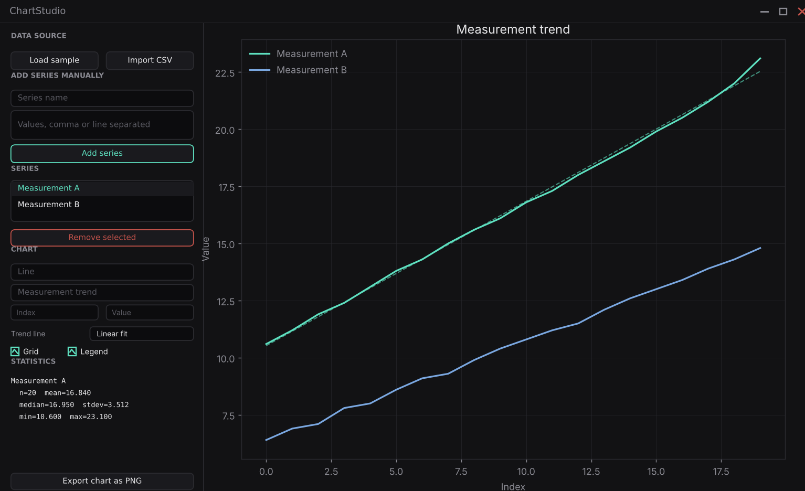
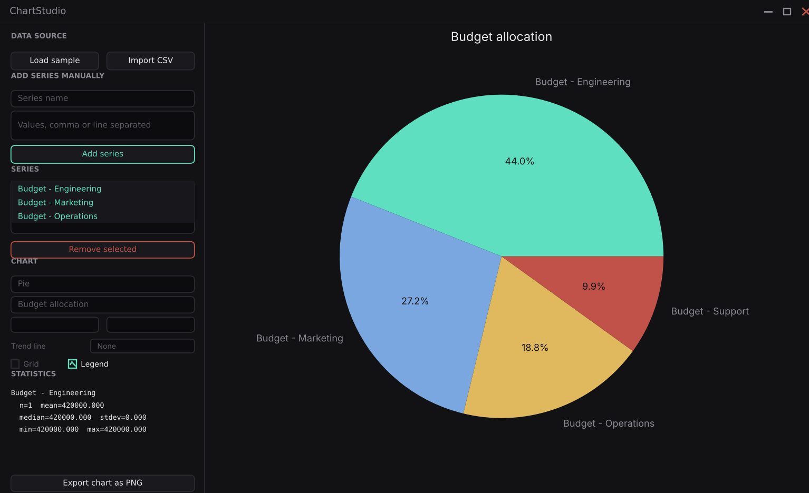

# ChartStudio

A PyQt6 desktop app for plotting statistics and engineering charts:
line, bar, scatter, histogram, box plot, pie, and error-bar (mean ± SE),
with trend overlays, normalization, and log scaling.

## Preview





These two images are **design mockups**, not live screen captures: this
project was built in a sandbox with no network access and no display, so
PyQt6 could not be installed or run here to take a real screenshot. The
mockups were generated with matplotlib using the exact color, spacing and
font values from `ui/style.py`, laid out to match `ui/main_window.py` and
`ui/widgets/control_panel.py` pixel-for-pixel in proportion, so they're an
accurate preview of the real layout -- but please treat them as a preview,
not proof the app runs. Run it locally (see below) and it should look
like this; if anything looks different, that's worth reporting back.

## Install

```bash
pip install -r requirements.txt
```

## Run

```bash
python main.py
```

## Run the tests

Core logic (data model, CSV import, statistics) has unit tests that run
with plain Python -- no PyQt6 install required, since they stub the two
Qt symbols `core/engine.py` needs (`QObject`, `pyqtSignal`):

```bash
python tests/test_stats.py
python tests/test_engine.py
```

## Features

- **Data input**: load bundled sample data, import a CSV (first column
  = labels, remaining columns = numeric series), or type series values
  in by hand.
- **Chart kinds**: line, bar, scatter, histogram, box plot, pie, and
  error-bar (mean ± standard error).
- **Trend overlays** (line charts): a dashed linear least-squares fit,
  or a centered moving average with an adjustable window.
- **Normalize (0-1)**: rescale each selected series to a common [0, 1]
  range, useful when comparing series on very different scales.
- **Log Y axis**: switch the Y axis to a logarithmic scale.
- **Per-series statistics**: count, mean, median, standard deviation,
  min, max -- shown live as you select series.
- Custom frameless dark window chrome with a drag-to-move title bar and
  hand-drawn minimize/maximize/close controls (no icon assets).
- Export the current chart as a PNG.

## Structure

- `core/` -- data model (`models.py`), CSV import and dataset ownership
  (`engine.py`), and pure statistics helpers (`stats.py`: linear
  regression, moving average, min-max normalization, standard error).
  No widget imports anywhere in this package.
- `ui/` -- the Qt window (`main_window.py`), the themed matplotlib
  canvas (`widgets/chart_canvas.py`), the side control panel
  (`widgets/control_panel.py`), and the frameless title bar
  (`widgets/title_bar.py`, `widgets/window_controls.py`).
- `tests/` -- unit tests for `core/`, runnable without PyQt6.
- `docs/screenshots/` -- preview images (see note above).
- `main.py` -- entry point.

## Verified in this environment

Without network access or a display here, the real PyQt6 window could
not be opened. What was verified directly instead:

- Every file parses with no syntax errors.
- All 16 unit tests in `tests/` pass, covering the dataset model, CSV
  import (including malformed values), summary statistics, linear
  regression, moving average, normalization, and standard error.
- Cross-checked by script that every `self.control_panel.*` and
  `self.engine.*` reference in `main_window.py` resolves to an
  attribute, method, or signal that actually exists on those classes
  -- catching wiring typos before they'd surface as a runtime error.
- Every matplotlib chart type used by `ChartCanvas` (line + trend
  overlays, bar, scatter, histogram, box plot, pie, error bar) was
  exercised standalone against the real matplotlib installed here and
  confirmed to render; this caught and fixed one real bug (a
  `boxplot(labels=...)` vs `boxplot(tick_labels=...)` API change
  across matplotlib versions, now handled with a fallback).

Not verified here: the live PyQt6 window opening, frameless
drag-to-move behavior, button hover states, and overall visual result
on your machine. Please run it locally and let me know if anything
looks off.
