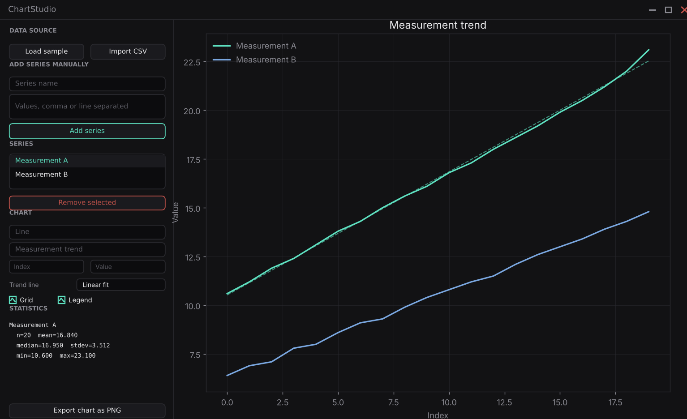
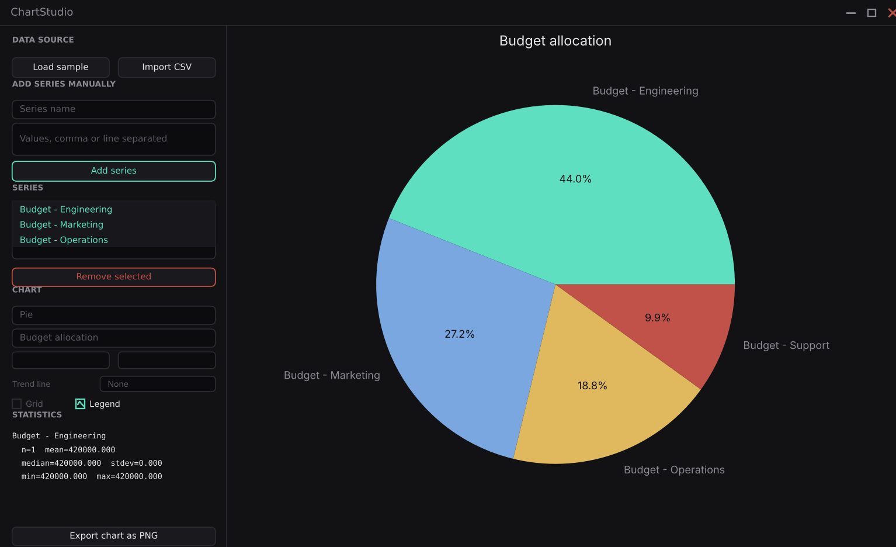
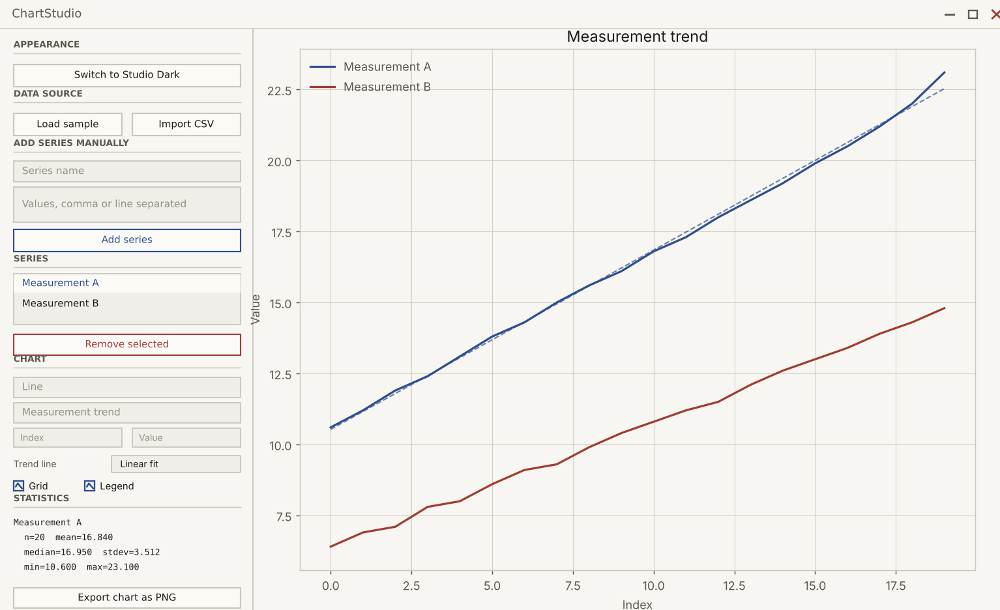
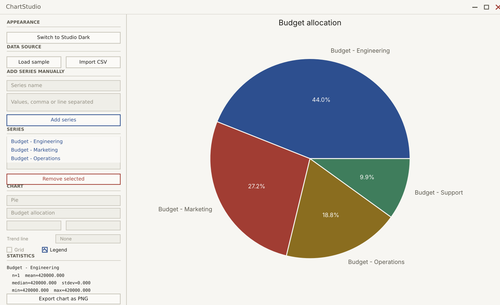

# ChartStudio

A PyQt6 desktop app for plotting statistics and engineering charts:
line, bar, scatter, histogram, box plot, pie, and error-bar (mean ± SE),
with trend overlays, normalization, log scaling, and two built-in themes.

## Themes

A button in the **APPEARANCE** section of the side panel switches
between:

- **Studio Dark** -- flat dark panels, soft 8px rounding, a mint accent.
- **Drafting Sheet** -- a light theme modeled on technical drafting
  paper and blueprint annotation: an off-white page, ink-black text,
  hairline rules instead of soft rounded cards, square-ish corners, and
  a single cobalt-ink accent used only for the primary action and data
  lines. Chart line colors also change to a blueprint-style palette
  (cobalt, brick red, olive, forest green) instead of the dark theme's
  mint/blue/gold set.

Switching is instant and affects the whole app in place: the
stylesheet, the window control glyphs, and the chart itself all re-read
the active theme and redraw -- no restart needed.

### Studio Dark





### Drafting Sheet (light)





These four images are **design mockups**, not live screen captures:
this project was built in a sandbox with no network access and no
display, so PyQt6 could not be installed or run here to take a real
screenshot. The mockups were generated with matplotlib using the exact
color, spacing, corner-radius and font values from `ui/style.py` for
each theme, laid out to match `ui/main_window.py` and
`ui/widgets/control_panel.py` in proportion, so they're an accurate
preview of the real layout and of how the two themes actually differ --
but please treat them as a preview, not proof the app runs. Run it
locally (see below) and it should look like this; if anything looks
different, that's worth reporting back.

## Install

```bash
pip install -r requirements.txt
```

## Run

```bash
python main.py
```

## Run the tests

Everything in `core/` and `ui/style.py` has unit tests that run with
plain Python -- no PyQt6 install required. `core/engine.py` is the one
file among these that imports PyQt6 (for `QObject`/`pyqtSignal`), so its
test stubs just those two symbols; `ui/style.py` uses no Qt imports at
all.

```bash
python tests/test_stats.py
python tests/test_engine.py
python tests/test_style.py
```

## Features

- **Data input**: load bundled sample data, import a CSV (first column
  = labels, remaining columns = numeric series), or type series values
  in by hand.
- **Chart kinds**: line, bar, scatter, histogram, box plot, pie, and
  error-bar (mean ± standard error).
- **Trend overlays** (line charts): a dashed linear least-squares fit,
  or a centered moving average with an adjustable window.
- **Normalize (0-1)**: rescale each selected series to a common [0, 1]
  range, useful when comparing series on very different scales.
- **Log Y axis**: switch the Y axis to a logarithmic scale.
- **Per-series statistics**: count, mean, median, standard deviation,
  min, max -- shown live as you select series.
- **Two themes** (Studio Dark / Drafting Sheet), switchable at runtime
  -- see above.
- Custom frameless window chrome with a drag-to-move title bar and
  hand-drawn minimize/maximize/close controls (no icon assets), themed
  to match whichever theme is active.
- Export the current chart as a PNG.

## Structure

- `core/` -- data model (`models.py`), CSV import and dataset ownership
  (`engine.py`), and pure statistics helpers (`stats.py`: linear
  regression, moving average, min-max normalization, standard error).
  No widget imports anywhere in this package.
- `ui/` -- the Qt window (`main_window.py`), the theme module
  (`style.py`: two `Theme` definitions plus `set_theme` /
  `toggle_theme` / `current_theme`), the themed matplotlib canvas
  (`widgets/chart_canvas.py`), the side control panel
  (`widgets/control_panel.py`), and the frameless title bar
  (`widgets/title_bar.py`, `widgets/window_controls.py`).
- `tests/` -- unit tests for `core/` and `ui/style.py`, runnable
  without PyQt6.
- `docs/screenshots/` -- preview images (see note above).
- `main.py` -- entry point.

### How theming works, for future changes

`ui/style.py` defines two `Theme` dataclass instances and keeps a
module-level "current theme" pointer. `set_theme()` / `toggle_theme()`
copy every field of the active theme onto plain module globals
(`style.BG_BASE`, `style.ACCENT`, `style.PLOT_LINE_COLORS`, ...), so
any code that does `from ui import style` and reads `style.BG_BASE` at
call time (not import time) automatically sees the new values after a
switch -- `ui/widgets/chart_canvas.py` and
`ui/widgets/window_controls.py` both do this. `MainWindow._on_theme_toggle`
is what actually triggers a switch: it calls `style.toggle_theme()`,
re-applies `style.build_stylesheet()` to the `QApplication`, updates the
toggle button's label, and re-renders the current chart so its colors
pick up the new palette immediately.

If you add a new widget that needs theme-aware colors outside of QSS
(custom-painted widgets like `WindowControlButton`), read the color
from `style.X` inside `paintEvent`/`render`, not as a value captured
once in `__init__` -- that's what makes it respond to a later theme
switch without extra wiring.

## Verified in this environment

Without network access or a display here, the real PyQt6 window could
not be opened. What was verified directly instead:

- Every file parses with no syntax errors.
- All 22 unit tests in `tests/` pass: the dataset model, CSV import
  (including malformed values), summary statistics, linear regression,
  moving average, normalization, standard error, and the theme module
  (default theme, switching, toggling, round-tripping, rejecting an
  unknown theme name, and the stylesheet actually reflecting the
  active theme).
- Cross-checked by script that every `self.control_panel.*`,
  `self.engine.*`, and `style.*` reference in `main_window.py` resolves
  to an attribute, method, function, or signal that actually exists --
  catching wiring typos before they'd surface as a runtime error.
- Every matplotlib chart type used by `ChartCanvas` (line + trend
  overlays, bar, scatter, histogram, box plot, pie, error bar) was
  exercised standalone against the real matplotlib installed here,
  under both themes, and confirmed to render; this caught and fixed one
  real bug (a `boxplot(labels=...)` vs `boxplot(tick_labels=...)` API
  change across matplotlib versions, now handled with a fallback).

Not verified here: the live PyQt6 window opening, frameless
drag-to-move behavior, button hover states, and the actual in-app
theme-toggle button click triggering a repaint on your machine. Please
run it locally and let me know if anything looks off.
