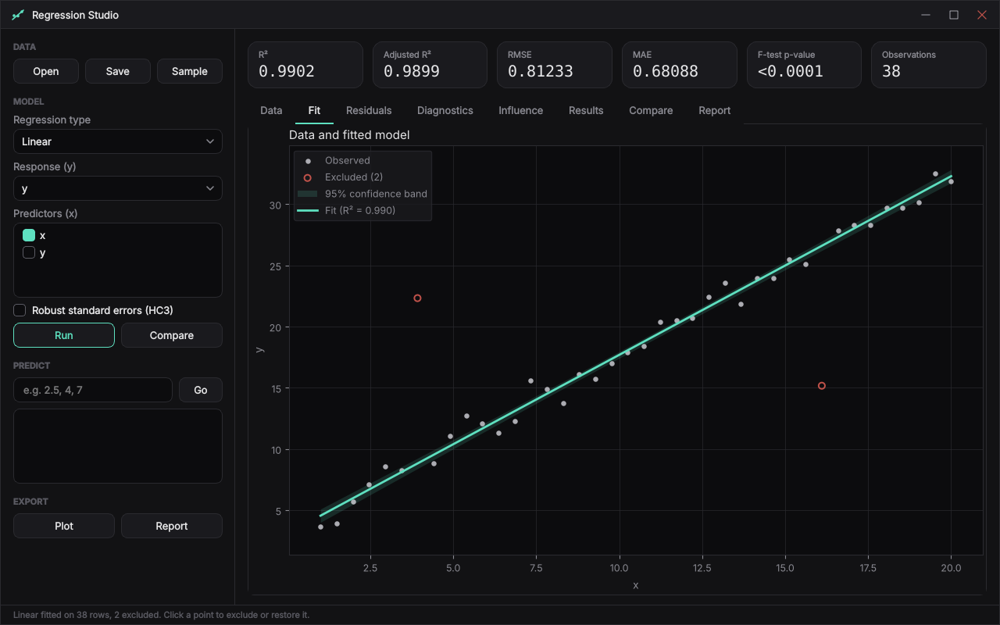
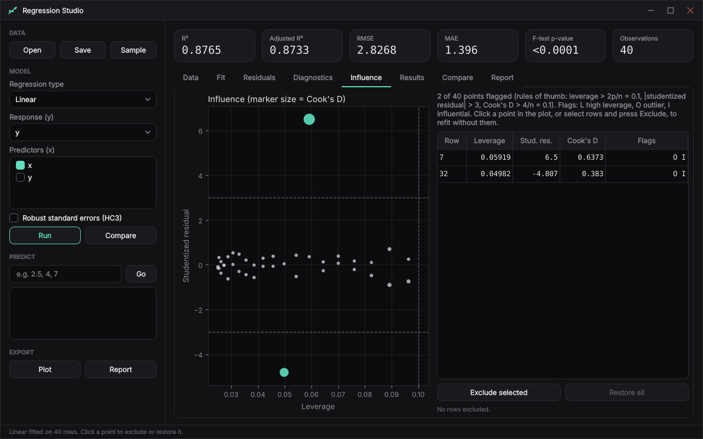

# Regression Studio

A desktop application for regression analysis. Enter or paste your data, pick a model, and get fit statistics, coefficient tests, prediction intervals and diagnostic plots in one dashboard.



## Features

- **Data entry**: editable grid with spreadsheet paste (Ctrl+V, header row detected automatically), copy, delete, CSV/TSV import and CSV export. Persian and Arabic-Indic digits are accepted.
- **Models**: linear, polynomial (degree 1 to 10), exponential, logarithmic, power, and multiple linear regression.
- **Dashboard cards**: R², adjusted R², RMSE, MAE, F-test p-value, observation count.
- **Results**: equation, coefficient table (estimate, standard error, t, p-value, confidence interval), Durbin-Watson and Jarque-Bera tests, full text report.
- **Outlier and influence analysis**: leverage, studentized residuals and Cook's distance, an influence plot, and a table of flagged points. **Click any point** in the Fit, Residuals or Influence plot to exclude it and refit instantly; click the hollow marker to bring it back.
- **Robust inference**: optional HC3 standard errors, plus a Breusch-Pagan test for non-constant variance.
- **Plots**: fit with 95% confidence band (observed vs predicted for multiple regression), residuals vs fitted, residual histogram, normal Q-Q. Export as PNG, SVG or PDF.
- **Predict**: point predictions with confidence and prediction intervals; values outside the data range are flagged.
- **Compare**: fits every single-predictor model and ranks them by 5-fold cross-validated RMSE.
- Fitting and file I/O run on a worker thread, so the window stays responsive on large tables.



## Install

Requires Python 3.10 or newer.

```bash
git clone https://github.com/<your-user>/regression-studio.git
cd regression-studio
python -m venv .venv
source .venv/bin/activate        # Windows: .venv\Scripts\activate
pip install -e .
```

Run it:

```bash
regression-studio
# or
python -m regression_studio
```

## Usage

1. **Data tab**: type values, paste from a spreadsheet, or use **Open** for a CSV. **Sample** loads demo data.
2. **Model** (sidebar): choose the regression type, the response (y) and the predictor (x) columns. Multiple linear regression allows several predictors; all other types take exactly one.
3. **Run** (or F5 / Ctrl+Enter). The Fit tab opens; check Residuals, Diagnostics, Results and Report.
4. **Predict**: enter x values (`2.5, 4, 7`). For several predictors, separate the values of one point with commas and points with semicolons (`5, 2; 8, 1`).
5. **Compare** ranks all single-predictor models if you are unsure which form fits.
6. **Influence**: look for flagged points. Click a point in the plot (or select rows in the table and press **Exclude selected**) to refit without it. Excluded points stay visible as hollow red markers; **Restore all** undoes every exclusion. `examples/outliers.csv` has two planted outliers to try this on.
7. Tick **Robust standard errors (HC3)** in the sidebar if the residual variance is not constant (see the Breusch-Pagan line in the Report tab).

Rows with missing values in the selected columns are skipped. Fully blank rows are ignored silently.

## Statistical notes

- All models are fitted by ordinary least squares (QR decomposition). Polynomials are fitted on a centered and scaled x for numerical stability and reported in the original x units.
- Exponential and power models are fitted by regressing ln(y) on x (or ln(x)). Their coefficient table, F-test and residual standard error describe the log-linearized model. R², RMSE and MAE are computed on the original y scale. Fitted values are back-transformed medians without bias correction.
- p-values and confidence intervals use Student's t and F distributions, implemented in `core/stats.py` with no scipy dependency; the test suite checks them against scipy.
- Influence measures refer to the fitted scale (log scale for exponential and power models). The flag rules are common rules of thumb, not tests: leverage > 2p/n, |studentized residual| > 3, Cook's D > 4/n. Flagging a point is a prompt to look at it, not a reason to delete it; the report lists excluded rows so the decision stays visible.
- Exclusions are table row numbers. They are cleared when rows are deleted or the table is replaced, because the row identity would no longer be reliable.
- HC3 changes standard errors, t-tests and coefficient confidence intervals. The F-test and the prediction and confidence bands still assume constant variance.
- Breusch-Pagan is Koenker's studentized form (robust to non-normal errors).
- Durbin-Watson is only meaningful when rows are in sequence order.
- In the Compare tab, R² and RMSE are in-sample and always favour more flexible models; use the cross-validated RMSE for ranking.

## Project layout

```
src/regression_studio/
    core/        analysis logic, no Qt imports (stats, diagnostics, data, io, engine, report)
    ui/          PyQt6 interface: main_window (wiring), sidebar, data/results/compare/influence
                 pages, plots, table, title_bar, workers, style
    main.py      entry point
tests/           pytest suite (core against numpy/scipy and direct formulas, UI tests offscreen)
examples/        sample.csv, outliers.csv
```

The UI imports `core`; `core` never imports the UI, so the engine can be reused or tested on its own.

## Development

```bash
pip install -e ".[dev]"
pytest
```

UI tests run headless (`QT_QPA_PLATFORM=offscreen`, set in `tests/conftest.py`). On Linux CI you may need `libegl1 libgl1 libxkbcommon0 libdbus-1-3 libfontconfig1`.

## Platform notes

The window is frameless with a custom title bar. Moving uses the window system's native move where available (X11, Windows, macOS, Wayland); resizing uses the grip in the bottom-right corner.

## License

MIT. See [LICENSE](LICENSE).
